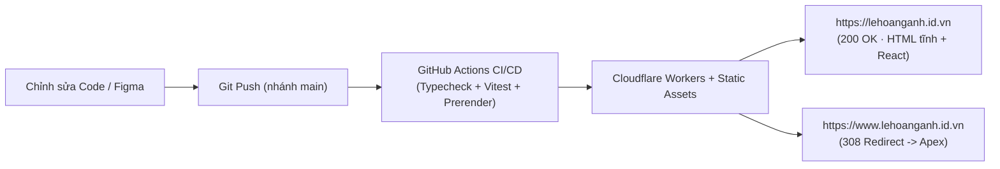

# Hướng Dẫn Vận Hành & Bảo Trì Portfolio (`lehoanganh.id.vn`)

Tài liệu này tổng hợp toàn bộ quy trình vận hành, chỉnh sửa nội dung, đồng bộ Figma, triển khai tự động (CI/CD), giám sát và khôi phục sự cố cho trang portfolio cá nhân của **Lê Hoàng Anh**.

---

## 1. Tổng Quan Kiến Trúc & Chi Phí Duy Trì



| Hạng mục | Nền tảng quản lý | Chi phí | Ghi chú vận hành |
| :--- | :--- | :--- | :--- |
| **Hosting & CDN** | Cloudflare Workers Static Assets (`lehoanganh-portfolio`) | **0 đ / tháng** | Cấu hình `run_worker_first: ["/*", "!/assets/*"]` giúp toàn bộ ảnh/CSS/JS đi thẳng qua Static Assets miễn phí không giới hạn, không tiêu tốn hạn mức 100.000 Worker requests/ngày của gói Free. |
| **Chứng chỉ SSL/HTTPS** | Cloudflare Universal SSL | **0 đ / tháng** | Tự động cấp phát và tự động gia hạn hoàn toàn. |
| **CI/CD Tự động** | GitHub Actions (`.github/workflows/deploy.yml`) | **0 đ / tháng** | Tự kiểm tra lỗi TypeScript, chạy 10 bài test và tự deploy mỗi khi `git push`. |
| **Tên miền (`lehoanganh.id.vn`)** | Nhà đăng ký tên miền (Mắt Bão / VNNIC) + Cloudflare DNS | Theo phí gia hạn năm của `.id.vn` | Giữ nguyên cặp Nameserver trên nhà đăng ký là `ian.ns.cloudflare.com` và `iris.ns.cloudflare.com`. |

---

## 2. Bản Đồ Thư Mục — Sửa Nội Dung Ở Đâu?

```text
lehoanganh-portfolio/
├── .github/workflows/deploy.yml   # Tự động test + build + deploy khi push lên GitHub
├── public/
│   ├── assets/figma/              # 130 file SVG/PNG xuất trực tiếp từ Figma
│   ├── _headers                   # Cache-Control & Security Headers trên Cloudflare
│   ├── _redirects                 # Quy tắc redirect tĩnh dự phòng
│   ├── robots.txt                 # Cho phép Googlebot thu thập dữ liệu
│   └── sitemap.xml                # Danh sách 12 URL chuẩn SEO nộp cho Google
├── scripts/
│   └── prerender.mjs              # Xuất sẵn 13 route ra HTML tĩnh + dist/404.html
├── src/
│   ├── components/                # Header, Footer, GlassPrimitives, MotionPrimitives
│   ├── features/                  # 5 mô-đun tương tác (Kite, Budget, Reminder, States)
│   ├── pages/                     # 13 trang giao diện (Desktop 1280px & Mobile 390px)
│   ├── seo/routeMeta.ts           # Title, Meta Description, OpenGraph & JSON-LD từng trang
│   ├── styles/app.css             # Biến màu Portfolio/*, font chữ & class .glass-*
│   ├── App.tsx                    # Định tuyến React Router & MotionConfig
│   └── worker.ts                  # Edge Worker (chuyển hướng www -> apex, URL cũ, mã 404)
├── tests/portfolio.test.tsx       # Bộ kiểm thử tự động (Vitest + SSR Hydration)
├── deploy-cloudflare.ps1          # Script deploy nhanh 1 lệnh trên Windows
└── wrangler.jsonc                 # Cấu hình Cloudflare Worker & Custom Domains
```

### Các tác vụ cập nhật thường gặp

1. **Đổi tiêu đề, trạng thái tìm việc (Open to work) hoặc thông tin liên hệ**:
   - Trang chủ (Hero, Selected Work): sửa `src/pages/HomePage.tsx`
   - Giới thiệu bản thân & học vấn/kỹ năng: sửa `src/pages/AboutPage.tsx`
   - Email, liên kết mạng xã hội: sửa `src/pages/ContactPage.tsx` và `src/components/SiteFooter.tsx`

2. **Thêm một bài viết mới vào Journal (hoặc Case Study mới)**:
   - **Bước 1**: Tạo trang mới trong `src/pages/` (ví dụ `src/pages/NoteDesignTokensPage.tsx`).
   - **Bước 2**: Mở `src/App.tsx`:
     - Thêm đường dẫn mới (ví dụ `'/journal/design-tokens'`) vào tập `JOURNAL_PATHS` (hoặc `WORK_PATHS` nếu là dự án mới). *Lưu ý quan trọng: việc khai báo vào Set này đảm bảo thanh điều hướng đồng bộ giữa bản SSR và Client Hydration.*
     - Thêm `<Route path="/journal/design-tokens" element={<NoteDesignTokensPage />} />`.
   - **Bước 3**: Mở `src/seo/routeMeta.ts`, thêm cấu hình `title`, `description`, `ogImage` cho route mới vào `ROUTE_META`. *(Script `scripts/prerender.mjs` tự động đọc `ROUTE_META` để sinh file HTML tĩnh khi build!)*
   - **Bước 4**: Thêm thẻ bài viết vào danh sách ở `src/pages/JournalPage.tsx` và bổ sung `<url>` vào `public/sitemap.xml`.

3. **Cập nhật hình ảnh hoặc đồng bộ lại từ Figma**:
   - Đặt ảnh mới vào `public/assets/figma/` (ưu tiên `.svg` cho icon/vector, `.png` hoặc `.webp` đã nén cho ảnh chụp màn hình).
   - Nếu bạn chỉnh sửa trên file Figma gốc (`5Qnob5bMFrPr1ytJgH05ts`), mở thư mục dự án trong **Antigravity** và gọi `/figma-design-to-code` kèm link frame vừa sửa để cập nhật đúng component.

---

## 3. Hai Cách Triển Khai Bản Cập Nhật (Deploy)

### Cách 1: Tự động qua GitHub Actions (Khuyên dùng lâu dài)

Sau khi đẩy dự án lên GitHub, mỗi lần bạn sửa code và chạy `git push origin main`, GitHub sẽ tự động chạy kiểm tra lỗi và cập nhật thẳng lên `https://lehoanganh.id.vn`.

**Thiết lập 1 lần duy nhất trên GitHub**:
1. Lấy **Account ID**: Mở Cloudflare Dashboard -> chọn domain `lehoanganh.id.vn` -> kéo xuống cột phải mục **API** -> copy **Account ID**.
2. Tạo **API Token**: Truy cập `https://dash.cloudflare.com/profile/api-tokens` -> **Create Token** -> bấm **Use template** ở dòng **Edit Cloudflare Workers**:
   - **Account Resources**: `Include` -> tài khoản của bạn.
   - **Zone Resources**: `Include` -> `Specific zone` -> `lehoanganh.id.vn`.
   - Bấm **Continue to summary** -> **Create Token** -> copy mã token.
3. Trên kho GitHub của dự án (`https://github.com/lehoaga2k5/UiPortfolioHa`), vào **Settings** -> **Secrets and variables** -> **Actions** (`https://github.com/lehoaga2k5/UiPortfolioHa/settings/secrets/actions`) -> **New repository secret** và thêm 2 biến:
   - `CLOUDFLARE_ACCOUNT_ID`: dán Account ID vừa lấy.
   - `CLOUDFLARE_API_TOKEN`: dán API Token vừa tạo.

Từ thời điểm đó, quy trình cập nhật hằng ngày của bạn chỉ gồm 3 lệnh:
```powershell
git add -A
git commit -m "content: cap nhat du an moi"
git push origin main
```

---

### Cách 2: Chạy và Deploy trực tiếp từ máy cá nhân (Local CLI)

Khi muốn xem trước trên máy và đẩy thẳng lên Cloudflare ngay lập tức không cần chờ CI:

```powershell
# 1. Chạy môi trường phát triển (tự động reload tại http://localhost:5173)
npm run dev

# 2. Chạy kiểm tra TypeScript & 10 bài test tự động (bắt lỗi giao diện/hydration sớm)
npx tsc --noEmit
npm test

# 3. Build prerender 13 trang HTML & đẩy thẳng lên lehoanganh.id.vn
npm run deploy
# Hoặc chạy script tự động kiểm tra đăng nhập:
.\deploy-cloudflare.ps1
```

---

## 4. Đăng Ký SEO Google & Kiểm Tra Chia Sẻ Mạng Xã Hội

Để nhà tuyển dụng gõ **"Lê Hoàng Anh UI/UX"** hoặc xem link portfolio trên LinkedIn/Facebook/Zalo hiển thị đẹp nhất:

1. **Google Search Console**:
   - Truy cập `https://search.google.com/search-console` -> thêm Property dạng **Domain** (`lehoanganh.id.vn`) -> bấm xác minh tự động qua Cloudflare DNS.
   - Vào mục **Sitemaps** -> nhập `https://lehoanganh.id.vn/sitemap.xml` -> bấm **Submit**.
2. **Làm mới ảnh Thumbnail khi gửi link (Open Graph)**:
   - Mỗi trang đã có sẵn thẻ `og:title`, `og:description` và `og:image` (`99709.png` / ảnh bìa từng dự án).
   - Nếu đổi ảnh đại diện mới mà Facebook/LinkedIn còn lưu cache cũ, dán link vào **Facebook Sharing Debugger** hoặc **LinkedIn Post Inspector** bấm *Scrape Again*.

---

## 5. Giám Sát, Xử Lý Sự Cố & Khôi Phục Tức Thì (Rollback)

### Khôi phục phiên bản cũ trong 5 giây (Rollback)
Nếu bạn lỡ cập nhật nhầm nội dung lên trang chính thức, Cloudflare lưu sẵn lịch sử các phiên bản (`Deployments`):
- **Bằng dòng lệnh**:
  ```powershell
  npx wrangler deployments list
  npx wrangler rollback
  ```
- **Trên giao diện web Cloudflare**: Vào **Compute (Workers)** -> **Workers & Pages** -> **`lehoanganh-portfolio`** -> tab **Deployments** -> bấm dấu `...` ở phiên bản ổn định trước đó -> chọn **Rollback to this deployment**.

### Xem log truy cập thời gian thực tại Edge
```powershell
npx wrangler tail
```

### Các lưu ý tránh lỗi thường gặp
- **Không xóa `dist/404.html`**: File này được sinh tự động bởi `npm run build` để Cloudflare trả đúng giao diện Not Found kèm mã HTTP `404`.
- **Tránh lỗi Hydration `#418`**: Không dùng `Math.random()`, `new Date()` hoặc đọc trực tiếp `window.innerWidth` ngay trong thân hàm render đầu tiên của React; hãy đặt trong `useEffect` để HTML tĩnh lúc build khớp 100% với lúc trình duyệt chạy. Chạy `npm test` sẽ tự động kiểm tra toàn bộ 13 route cho bạn trước khi deploy.
